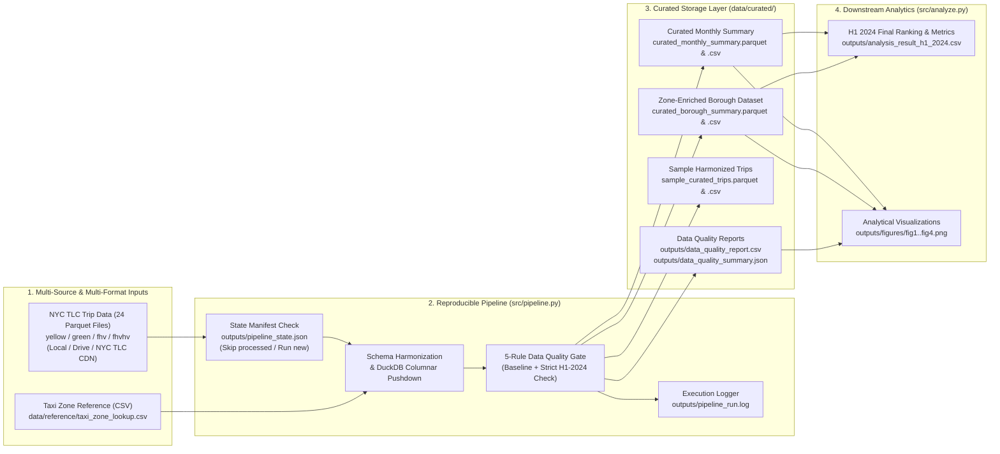
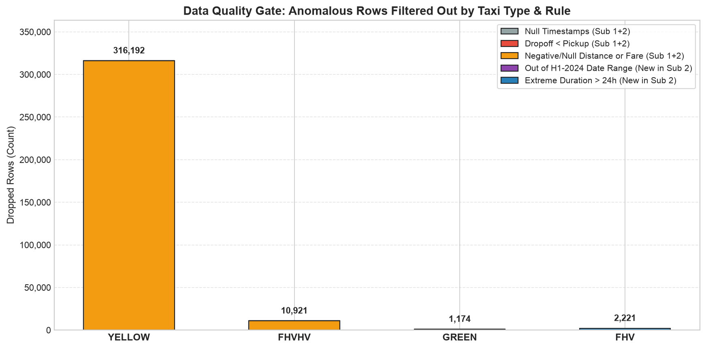
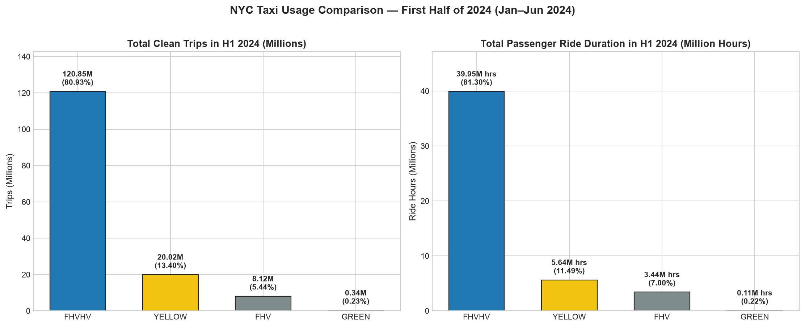
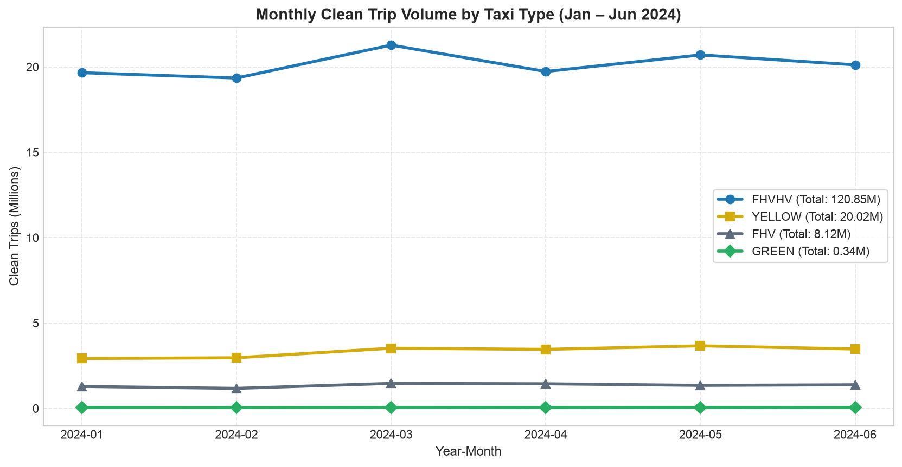
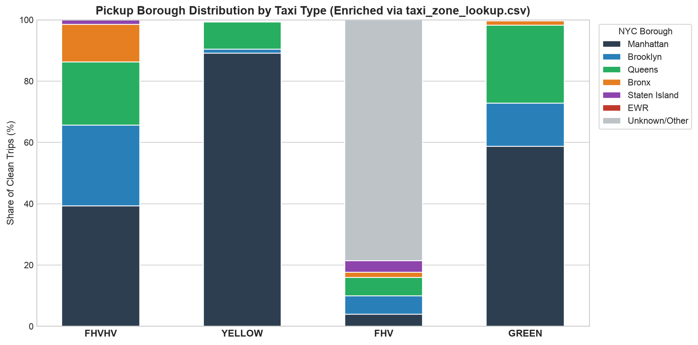

# CS341 — NYC Taxi Reproducible Data Pipeline (Submission 2)

> **โจทย์หลัก (Research Question):** *"Which taxi type was the most used in the first half of 2024?"*  
> **คำตอบจากการวิเคราะห์บน Curated Output:** **`FHVHV` (High-Volume For-Hire Vehicles เช่น Uber / Lyft)** เป็นประเภทแท็กซี่ที่ถูกใช้งานมากที่สุดในช่วงครึ่งแรกของปี 2024 (ม.ค. – มิ.ย. 2024) ทั้งในมิติ **จำนวนการเดินทาง (120,853,747 เที่ยว หรือ 80.93% ของทั้งหมด)** และมิติ **เวลาให้บริการผู้โดยสารรวม (39,945,509.26 ชั่วโมง หรือ 81.30% ของทั้งหมด)**

---

## สารบัญ (Table of Contents)
1. [ภาพรวมและข้อมูลที่ใช้ (Data Sources & Multi-Format Integration)](#1-ภาพรวมและข้อมูลที่ใช้-data-sources--multi-format-integration)
2. [โครงสร้าง Pipeline และ Data Flow Diagram](#2-โครงสร้าง-pipeline-และ-data-flow-diagram)
3. [โครงสร้างไฟล์ใน Repository](#3-โครงสร้างไฟล์ใน-repository)
4. [วิธีติดตั้งและวิธีรัน (Installation & Execution Guide)](#4-วิธีติดตั้งและวิธีรัน-installation--execution-guide)
5. [หลักฐานการรัน Pipeline และความสามารถในการรันซ้ำ (Execution Evidence & Idempotency)](#5-หลักฐานการรัน-pipeline-และความสามารถในการรันซ้ำ-execution-evidence--idempotency)
6. [ผลการตรวจสอบคุณภาพข้อมูล (Data Quality Report)](#6-ผลการตรวจสอบคุณภาพข้อมูล-data-quality-report)
7. [ตัวอย่างชุดข้อมูลพร้อมใช้ (Curated Output Datasets)](#7-ตัวอย่างชุดข้อมูลพร้อมใช้-curated-output-datasets)
8. [ผลการวิเคราะห์เพื่อตอบโจทย์หลัก (Analytical Results)](#8-ผลการวิเคราะห์เพื่อตอบโจทย์หลัก-analytical-results)
9. [การตัดสินใจสำคัญในการออกแบบ Pipeline (Key Design Decisions)](#9-การตัดสินใจสำคัญในการออกแบบ-pipeline-key-design-decisions)
10. [สรุปพัฒนาการจาก Submission 1 สู่ Submission 2](#10-สรุปพัฒนาการจาก-submission-1-สู่-submission-2)
11. [ข้อจำกัดของ Pipeline ปัจจุบัน (Current Limitations)](#11-ข้อจำกัดของ-pipeline-ปัจจุบัน-current-limitations)
12. [Learning Reflection](#12-learning-reflection)

---

## 1. ภาพรวมและข้อมูลที่ใช้ (Data Sources & Multi-Format Integration)

งานชิ้นนี้พัฒนาต่อยอดจาก **Submission 1 (`NYC_Taxi.ipynb`)** ให้เป็น **Reproducible Data Pipeline** ที่เชื่อมและบูรณาการข้อมูลจาก **หลายแหล่งและหลายรูปแบบโครงสร้าง** ของหน่วยงาน **NYC Taxi and Limousine Commission (TLC)** ในช่วงครึ่งแรกของปี 2024 (`2024-01` ถึง `2024-06`):

### 1.1 ข้อมูลการเดินทางรายเที่ยว (Trip Record Data — 24 ไฟล์ Parquet, 4 โครงสร้าง Schema)
ข้อมูลดิบประกอบด้วยไฟล์ `.parquet` จำนวน 24 ไฟล์ (4 ประเภทแท็กซี่ × 6 เดือน) รวมทั้งสิ้น **149,655,796 แถว** (ขนาดไฟล์ดิบรวม ~3.12 GB) ซึ่งแต่ละประเภทมีชื่อคอลัมน์และโครงสร้างแตกต่างกัน:

| ประเภทแท็กซี่ (`taxi_type`) | รายละเอียด | คอลัมน์เวลาขึ้น–ลงรถ | คอลัมน์จุดขึ้น–ลงรถ | คอลัมน์ระยะทาง | คอลัมน์ค่าโดยสารพื้นฐาน | จำนวนไฟล์ (ม.ค.–มิ.ย. 2024) |
| :--- | :--- | :--- | :--- | :--- | :--- | :---: |
| **`fhvhv`** | High-Volume For-Hire Vehicles (App Rideshare: Uber, Lyft) | `pickup_datetime`, `dropoff_datetime` | `PULocationID`, `DOLocationID` | `trip_miles` | `base_passenger_fare` | 6 ไฟล์ |
| **`yellow`** | Yellow Medallion Taxicabs (เรียกริมทางในเขตเมือง/สนามบิน) | `tpep_pickup_datetime`, `tpep_dropoff_datetime` | `PULocationID`, `DOLocationID` | `trip_distance` | `fare_amount` | 6 ไฟล์ |
| **`fhv`** | Traditional For-Hire Vehicles (รถรับจ้างชุมชน/Livery/Limousine) | `pickup_datetime`, `dropOff_datetime` *(ตัว O พิมพ์ใหญ่)* | `PUlocationID`, `DOlocationID` *(ตัว l พิมพ์เล็ก)* | *ไม่มีคอลัมน์ระยะทาง* (`NULL`) | *ไม่มีคอลัมน์ค่าโดยสาร* (`NULL`) | 6 ไฟล์ |
| **`green`** | Green Boro Taxis (ให้บริการพื้นที่รอบนอก Manhattan) | `lpep_pickup_datetime`, `lpep_dropoff_datetime` | `PULocationID`, `DOLocationID` | `trip_distance` | `fare_amount` | 6 ไฟล์ |

### 1.2 ข้อมูลอ้างอิงพื้นที่ให้บริการ (Taxi Zone Lookup Table — รูปแบบ CSV)
- **ไฟล์:** [`data/reference/taxi_zone_lookup.csv`](data/reference/taxi_zone_lookup.csv) (265 โซน)
- **แหล่งที่มา:** `https://d37ci6vzurychx.cloudfront.net/misc/taxi_zone_lookup.csv`
- **การบูรณาการ:** นำมาเชื่อม (JOIN) กับรหัส `pu_location_id` และ `do_location_id` ของไฟล์ Parquet ทั้ง 4 ประเภท เพื่อระบุเขตพื้นที่ (`Borough`: Manhattan, Brooklyn, Queens, Bronx, Staten Island, EWR) และชื่อย่าน (`Zone`)

---

## 2. โครงสร้าง Pipeline และ Data Flow Diagram

Pipeline ออกแบบตามสถาปัตยกรรม **Medallion / Multi-Stage Data Pipeline** ที่แยกส่วนการนำเข้า-ทำความสะอาดข้อมูล (ETL) ออกจากส่วนการวิเคราะห์ผล (Analytics) อย่างชัดเจน:



---

## 3. โครงสร้างไฟล์ใน Repository

```text
CS341_Submission-2-/
├── README.md                                  # เอกสารอธิบายโครงสร้าง วิธีรัน ผลลัพธ์ และการสะท้อนการเรียนรู้
├── requirements.txt                           # รายการไลบรารีที่จำเป็นสำหรับการรัน Pipeline
├── NYC_Taxi_Pipeline_Sub2.ipynb               # Notebook สำหรับรันและแสดงผล Pipeline ของ Submission 2
├── src/
│   ├── __init__.py
│   ├── config.py                              # ตั้งค่า Path, URL, กฎ Data Quality และ Schema Mapping ทั้ง 4 ประเภท
│   ├── pipeline.py                            # โค้ดหลักของ Pipeline (Ingestion, Validation, Cleaning, State, Curated Output)
│   └── analyze.py                             # โค้ดประมวลผลตัวชี้วัดและสร้างกราฟจาก Curated Layer
├── data/
│   ├── reference/
│   │   └── taxi_zone_lookup.csv               # ตารางอ้างอิงโซนแท็กซี่ NYC (265 โซน)
│   └── curated/
│       ├── partitions/                        # ไฟล์ Curated ที่คลีนและจัดเก็บแยกทีละไฟล์ (24 Partitions)
│       │   ├── borough_by_file/*.parquet      # ข้อมูลสรุประดับเขตแยกตามไฟล์ (24 ไฟล์)
│       │   └── sample_by_file/*.parquet       # ตัวอย่างข้อมูลระดับแถวที่คลีนแล้วแยกตามไฟล์ (24 ไฟล์)
│       ├── curated_monthly_summary.parquet    # ชุดข้อมูลพร้อมใช้สรุปรายเดือน/ประเภทแท็กซี่ (Parquet)
│       ├── curated_monthly_summary.csv        # ชุดข้อมูลพร้อมใช้สรุปรายเดือน/ประเภทแท็กซี่ (CSV)
│       ├── curated_borough_summary.parquet    # ชุดข้อมูลพร้อมใช้ที่เชื่อมกับ Borough แล้ว (Parquet)
│       ├── curated_borough_summary.csv        # ชุดข้อมูลพร้อมใช้ที่เชื่อมกับ Borough แล้ว (CSV)
│       ├── sample_curated_trips.parquet       # ตัวอย่างข้อมูลระดับ Trip ที่ปรับ Schema มาตรฐานแล้ว (Parquet)
│       └── sample_curated_trips.csv           # ตัวอย่างข้อมูลระดับ Trip ที่ปรับ Schema มาตรฐานแล้ว (CSV, 1,200 แถว)
└── outputs/
    ├── pipeline_state.json                    # ไฟล์ Manifest เก็บสถานะแต่ละ Partition เพื่อรองรับการรันซ้ำ/อัปเดต
    ├── pipeline_run.log                       # บันทึกหลักฐานการรัน Pipeline พร้อม Timestamp
    ├── data_quality_report.csv                # รายงานผลการตรวจสอบคุณภาพข้อมูลแยกรายไฟล์ (24 ไฟล์)
    ├── data_quality_summary.json              # สรุปภาพรวมผลการตรวจสอบคุณภาพข้อมูล (JSON)
    ├── analysis_result_h1_2024.csv            # ตารางผลลัพธ์สุดท้ายที่ใช้ตอบโจทย์หลัก
    └── figures/                               # กราฟสรุปผลการวิเคราะห์และคุณภาพข้อมูล
        ├── fig1_most_used_taxi_h1_2024.png
        ├── fig2_monthly_trend_h1_2024.png
        ├── fig3_data_quality_breakdown.png
        └── fig4_borough_distribution.png
```

---

## 4. วิธีติดตั้งและวิธีรัน (Installation & Execution Guide)

### 4.1 การติดตั้งสภาพแวดล้อม (Setup)
ต้องใช้ Python 3.10 ขึ้นไป ติดตั้งไลบรารีผ่าน `pip` (หรือ `uv`):

```bash
git clone https://github.com/nustapark6709650334/CS341_Submission-2-.git
cd CS341_Submission-2-

python3 -m venv .venv
source .venv/bin/activate
pip install -r requirements.txt
```

### 4.2 การสั่งรัน Pipeline (Run Pipeline)
Pipeline รองรับ **Hybrid Source Resolution**: หากมีไฟล์ Parquet ใน `data/raw/` หรือ Google Drive จะอ่านจากเครื่องทันที แต่หากไม่มี จะดึงเฉพาะคอลัมน์ที่ต้องใช้จากเซิร์ฟเวอร์ทางการของ NYC TLC ผ่าน HTTP Range Request โดยอัตโนมัติ:

```bash
# 1. รัน Pipeline ปกติ (Idempotent / Incremental: ข้ามไฟล์ที่เคยประมวลผลเสร็จแล้วใน pipeline_state.json)
python -m src.pipeline

# 2. บังคับรันประมวลผลใหม่ทั้งหมดตั้งแต่ต้น (Force Full Re-run)
python -m src.pipeline --force --workers 3

# 3. เลือกรันเฉพาะบางเดือนหรือบางประเภทแท็กซี่ (เช่น เมื่อมีข้อมูลเดือนใหม่อัปเดต)
python -m src.pipeline --months 2024-06 --taxi-types yellow fhvhv
```

### 4.3 การรันวิเคราะห์ผลและสร้างกราฟจาก Curated Output
```bash
python -m src.analyze
```

*(หรือสามารถเปิดรันผ่าน Jupyter/Colab Notebook ได้โดยตรงที่ไฟล์ [`NYC_Taxi_Pipeline_Sub2.ipynb`](NYC_Taxi_Pipeline_Sub2.ipynb))*

---

## 5. หลักฐานการรัน Pipeline และความสามารถในการรันซ้ำ (Execution Evidence & Idempotency)

หลักฐานการทำงานของ Pipeline ถูกบันทึกไว้ใน [`outputs/pipeline_run.log`](outputs/pipeline_run.log) และ [`outputs/pipeline_state.json`](outputs/pipeline_state.json) แสดงให้เห็นทั้ง **การรันรอบแรก (Full Run)** และ **การรันซ้ำ (Idempotent Re-run)**:

### รอบที่ 1: ประมวลผลข้อมูลจริงทั้งหมด 24 ไฟล์ (149,655,796 แถว) — ใช้เวลา 30.52 วินาที
```text
2026-11-15 13:43:52 | INFO    | 🚀 STARTING NYC TAXI DATA PIPELINE (rule_version=2.0.0, force=False)
2026-11-15 13:43:52 | INFO    | [INGEST-REF] Downloading reference CSV from https://d37ci6vzurychx.cloudfront.net/misc/taxi_zone_lookup.csv
2026-11-15 13:43:52 | INFO    | [VALIDATED-REF] taxi_zone_lookup.csv loaded successfully (265 zones).
2026-11-15 13:43:52 | INFO    | [PLAN] Total partitions requested: 24 | To process: 24 | Skipped (cached): 0
2026-11-15 13:43:52 | INFO    | [PROCESSED] green_2024-01   | raw=    56,551 | sub1_clean=    56,369 | sub2_clean=    56,367 | dropped=   184 | time=0.37s
2026-11-15 13:43:55 | INFO    | [PROCESSED] fhv_2024-01     | raw= 1,290,116 | sub1_clean= 1,290,116 | sub2_clean= 1,289,685 | dropped=   431 | time=3.35s
2026-11-15 13:43:57 | INFO    | [PROCESSED] yellow_2024-01  | raw= 2,964,624 | sub1_clean= 2,927,120 | sub2_clean= 2,927,091 | dropped=37,533 | time=4.93s
...
2026-11-15 13:44:19 | INFO    | [PROCESSED] fhvhv_2024-06   | raw=20,123,226 | sub1_clean=20,123,027 | sub2_clean=20,123,027 | dropped=   199 | time=4.88s
2026-11-15 13:44:22 | INFO    | [CURATED] Saved monthly curated dataset (24 rows) -> data/curated/curated_monthly_summary.parquet
2026-11-15 13:44:22 | INFO    | [CURATED] Saved zone-enriched borough dataset (184 rows) -> data/curated/curated_borough_summary.parquet
2026-11-15 13:44:22 | INFO    | [CURATED] Saved sample row-level curated trips (1200 rows) -> data/curated/sample_curated_trips.csv
2026-11-15 13:44:22 | INFO    | ✅ PIPELINE COMPLETED SUCCESSFULLY in 30.52s (Processed: 24, Skipped: 0)
2026-11-15 13:44:22 | INFO    | 📊 Total Raw Rows: 149,655,796 | Sub1 Baseline Clean: 149,327,659 | Sub2 Strict Clean: 149,325,288
```

### รอบที่ 2: ทดสอบการรันซ้ำ (Idempotent Re-run) — ใช้เวลาเพียง 0.04 วินาที
เมื่อสั่ง `python -m src.pipeline` ซ้ำ ระบบตรวจสอบ `outputs/pipeline_state.json` พบว่าทั้ง 24 Partitions ประมวลผลด้วย `rule_version=2.0.0` เสร็จสมบูรณ์แล้ว จึงข้ามการดึงข้อมูลดิบและสร้างชุดข้อมูล Curated ทันที:
```text
2026-11-15 13:44:35 | INFO    | 🚀 STARTING NYC TAXI DATA PIPELINE (rule_version=2.0.0, force=False)
2026-11-15 13:44:35 | INFO    | [SKIP-IDEMPOTENT] yellow_2024-01  | Already processed at 2026-11-15T06:43:57.191140+00:00 (clean_rows=2,927,091)
...
2026-11-15 13:44:35 | INFO    | [PLAN] Total partitions requested: 24 | To process: 0 | Skipped (cached): 24
2026-11-15 13:44:35 | INFO    | ✅ PIPELINE COMPLETED SUCCESSFULLY in 0.04s (Processed: 0, Skipped: 24)
```

---

## 6. ผลการตรวจสอบคุณภาพข้อมูล (Data Quality Report)

ใน Submission 2 เราได้สร้างระบบ **Data Quality Gate** ที่ตรวจสอบความถูกต้องของข้อมูล 6 ขั้นตอน และบันทึกรายละเอียดลงใน [`outputs/data_quality_report.csv`](outputs/data_quality_report.csv) และ [`outputs/data_quality_summary.json`](outputs/data_quality_summary.json)

### 6.1 ตารางเปรียบเทียบกฎการคัดกรองข้อมูล (Submission 1 Baseline vs Submission 2 Strict DQ)

| ลำดับกฎ | รายละเอียดการตรวจสอบ (Data Quality Rule) | มีใน Sub 1? | มีใน Sub 2? | จำนวนแถวที่พบความผิดปกติ (H1 2024) | คำอธิบายสาเหตุในข้อมูลจริง |
| :---: | :--- | :---: | :---: | ---: | :--- |
| **Rule 0** | **Schema Validation**: ตรวจชื่อและชนิดคอลัมน์ก่อนประมวลผล | บางส่วน | ✅ | 0 ไฟล์ผิดพลาด (ผ่านครบ 24 ไฟล์) | ป้องกัน Pipeline พังกลางคันหากโครงสร้างไฟล์เปลี่ยน |
| **Rule 1** | **Null Timestamps**: `pickup_datetime IS NULL OR dropoff_datetime IS NULL` | ✅ | ✅ | **0 แถว** | ทุกแถวมีเวลาขึ้น-ลงรถระบุไว้ |
| **Rule 2** | **Negative Duration**: `dropoff_datetime < pickup_datetime` | ✅ | ✅ | **300 แถว** | เวลาลงรถเกิดก่อนเวลาขึ้นรถ (นาฬิกามิเตอร์คลาดเคลื่อน) |
| **Rule 3** | **Invalid Distance / Fare**: `trip_distance < 0` หรือ `fare_amount < 0` (หรือเป็น `NULL` ในกลุ่มที่มีมิเตอร์) | ✅ | ✅ | **327,837 แถว** | เกิดจากการปรับปรุงยอดเงินติดลบ (Refund/Dispute) หรือข้อมูลตกหล่นในกลุ่ม Yellow/FHVHV |
| **Rule 4** | **Out-of-Period Date Range** *(เพิ่มใหม่ใน Sub 2)*: `pickup_datetime` อยู่นอกช่วง `2024-01-01` ถึง `2024-06-30` | ❌ | ✅ | **43 แถว** | พบข้อมูลปี 2002, 2009, 2023 และ 2026 ปะปนอยู่ในไฟล์เดือน ม.ค.–มิ.ย. 2024 |
| **Rule 5** | **Extreme Trip Duration** *(เพิ่มใหม่ใน Sub 2)*: ระยะเวลาเดินทางต่อเที่ยวเกิน 24 ชั่วโมง (`> 1,440 นาที`) | ❌ | ✅ | **2,328 แถว** | พบบ่อยในกลุ่ม `fhv` (2,221 แถว) และ `yellow` จากการลืมปิดงานในระบบจ่ายงาน |
| **รวม** | **จำนวนแถวที่ถูกคัดออกทั้งหมด (Total Dropped Rows)** | **328,137 แถว** | **330,508 แถว** | **+2,371 แถวที่ตรวจพบเพิ่มใน Sub 2** | **คงเหลือข้อมูลสะอาด 149,325,288 แถว (Retention Rate 99.78%)** |

> **ความสามารถในการตรวจสอบย้อนกลับ (Reconciliation with Submission 1):**  
> ตัวเลข `submission1_baseline_clean_rows` ที่คำนวณจาก Pipeline ใน Submission 2 ได้เท่ากับ **`149,327,659` แถว** (คัดออก `328,137` แถว จากข้อมูลดิบ `149,655,796` แถว) ซึ่ง **ตรงกับผลลัพธ์ใน `NYC_Taxi.ipynb` ของ Submission 1 ทุกประการ 100%** และเมื่อเพิ่มกฎ Rule 4 และ Rule 5 ใน Submission 2 ทำให้คัดกรองข้อมูลผิดปกติที่หลุดรอดไปในรอบแรกได้เพิ่มอีก **2,371 แถว**



---

## 7. ตัวอย่างชุดข้อมูลพร้อมใช้ (Curated Output Datasets)

แทนที่จะคำนวณแล้วลบข้อมูลทิ้งใน RAM เหมือน Submission 1 ตัว Pipeline ใน Submission 2 ได้จัดเก็บชุดข้อมูลที่ทำความสะอาดและปรับมาตรฐานแล้วไว้ในโฟลเดอร์ [`data/curated/`](data/curated/) จำนวน 3 ชุด:

### 7.1 ชุดข้อมูลสรุปรายเดือนและประเภทแท็กซี่ (`data/curated/curated_monthly_summary.csv` & `.parquet`)
มีทั้งหมด 24 แถว (6 เดือน × 4 ประเภทแท็กซี่) ตัวอย่าง 8 แถวแรก:

| partition_key | year_month | taxi_type | raw_rows | baseline_clean_rows | strict_clean_rows | strict_dropped_rows | retention_rate_pct | total_duration_hours | avg_duration_minutes | total_distance_miles | avg_distance_miles | total_fare_usd | avg_fare_usd | top_pickup_borough |
| :--- | :--- | :--- | ---: | ---: | ---: | ---: | ---: | ---: | ---: | ---: | ---: | ---: | ---: | :--- |
| `fhv_2024-01` | 2024-01 | fhv | 1,290,116 | 1,290,116 | 1,289,685 | 431 | 99.9666 | 540,956.40 | 25.17 | *NULL* | *NULL* | *NULL* | *NULL* | Unknown |
| `fhvhv_2024-01` | 2024-01 | fhvhv | 19,663,930 | 19,663,739 | 19,663,739 | 191 | 99.9990 | 6,160,641.20 | 18.80 | 95,409,500.51 | 4.85 | 468,940,384.08 | 23.85 | Manhattan |
| `green_2024-01` | 2024-01 | green | 56,551 | 56,369 | 56,367 | 184 | 99.6746 | 17,058.51 | 18.16 | 1,092,990.51 | 19.39 | 946,668.42 | 16.79 | Manhattan |
| `yellow_2024-01` | 2024-01 | yellow | 2,964,624 | 2,927,120 | 2,927,091 | 37,533 | 98.7340 | 757,498.54 | 15.53 | 10,803,561.47 | 3.69 | 53,955,612.24 | 18.43 | Manhattan |
| `fhv_2024-02` | 2024-02 | fhv | 1,176,093 | 1,176,093 | 1,175,314 | 779 | 99.9338 | 499,687.21 | 25.51 | *NULL* | *NULL* | *NULL* | *NULL* | Unknown |
| `fhvhv_2024-02` | 2024-02 | fhvhv | 19,359,148 | 19,350,636 | 19,350,636 | 8,512 | 99.9560 | 6,083,952.14 | 18.86 | 93,262,158.92 | 4.82 | 465,614,132.45 | 24.06 | Manhattan |
| `green_2024-02` | 2024-02 | green | 53,577 | 53,405 | 53,405 | 172 | 99.6790 | 16,133.42 | 18.13 | 909,949.55 | 17.04 | 892,504.33 | 16.71 | Manhattan |
| `yellow_2024-02` | 2024-02 | yellow | 3,007,526 | 2,966,864 | 2,966,850 | 40,676 | 98.6475 | 787,773.60 | 15.93 | 9,858,649.18 | 3.32 | 53,979,017.16 | 18.19 | Manhattan |

### 7.2 ตัวอย่างชุดข้อมูลระดับแถวที่ปรับ Schema มาตรฐานและเชื่อมชื่อโซนแล้ว (`data/curated/sample_curated_trips.csv`)
เก็บตัวอย่างข้อมูลระดับการเดินทาง (1,200 แถวจากทั้ง 24 ไฟล์) ที่มีโครงสร้างคอลัมน์เหมือนกันทุกประเภทแท็กซี่:

| taxi_type | year_month | pickup_datetime | dropoff_datetime | trip_duration_minutes | pu_location_id | pickup_borough | pickup_zone | do_location_id | dropoff_borough | trip_distance_miles | fare_amount_usd |
| :--- | :--- | :--- | :--- | ---: | ---: | :--- | :--- | ---: | :--- | ---: | ---: |
| `yellow` | 2024-01 | 2024-01-01 00:57:55 | 2024-01-01 01:17:43 | 19.80 | 186 | Manhattan | Penn Station/Madison Sq West | 79 | Manhattan | 1.72 | 17.70 |
| `green` | 2024-01 | 2024-01-01 00:46:55 | 2024-01-01 00:58:25 | 11.50 | 236 | Manhattan | Upper East Side North | 239 | Manhattan | 1.98 | 12.80 |
| `fhv` | 2024-01 | 2024-01-01 00:08:00 | 2024-01-01 00:35:00 | 27.00 | 56 | Queens | Corona | 56 | Queens | *NULL* | *NULL* |
| `fhvhv` | 2024-01 | 2024-01-01 00:28:08 | 2024-01-01 01:05:39 | 37.52 | 161 | Manhattan | Midtown Center | 89 | Brooklyn | 11.08 | 42.19 |

---

## 8. ผลการวิเคราะห์เพื่อตอบโจทย์หลัก (Analytical Results)

ผลลัพธ์จากการรัน `python -m src.analyze` บนชุดข้อมูล Curated (บันทึกอยู่ใน [`outputs/analysis_result_h1_2024.csv`](outputs/analysis_result_h1_2024.csv)):

### 8.1 ตารางสรุปผลการเปรียบเทียบการใช้งานแท็กซี่ทั้ง 4 ประเภทในครึ่งแรกของปี 2024

| อันดับ (Rank) | ประเภทแท็กซี่ (`taxi_type`) | จำนวนเที่ยวสะอาด (Sub 2 Strict Trips) | สัดส่วนจำนวนเที่ยว (`Trip Share %`) | จำนวนเที่ยวใน Sub 1 (`Baseline Trips`) | เวลารวมที่ให้บริการผู้โดยสาร (`Total Ride Hours`) | สัดส่วนเวลารวม (`Duration Share %`) | เวลาเฉลี่ยต่อเที่ยว (`Avg Mins`) | ระยะทางรวม (`Total Miles`) | ค่าโดยสารพื้นฐานรวม (`Total Base Fare USD`) | เขตที่มีการขึ้นรถสูงสุด (`Top Borough`) |
| :---: | :--- | ---: | ---: | ---: | ---: | ---: | ---: | ---: | ---: | :--- |
| **🥇 1** | **`FHVHV`** | **120,853,747** | **80.93%** | 120,853,747 | **39,945,509.26** | **81.30%** | 19.83 นาที | 605,943,141.37 | \$3,101,489,450.28 | Manhattan (กระจายครบ 5 เขต) |
| **🥈 2** | **`YELLOW`** | **20,015,901** | **13.40%** | 20,016,046 | **5,643,314.84** | **11.49%** | 16.92 นาที | 93,495,722.82 | \$389,606,120.45 | Manhattan (~89%) |
| **🥉 3** | **`FHV`** | **8,117,007** | **5.44%** | 8,119,228 | **3,439,686.51** | **7.00%** | 25.43 นาที | *N/A* | *N/A* | Unknown / Outer Boroughs |
| **4** | **`GREEN`** | **338,633** | **0.23%** | 338,638 | **106,641.89** | **0.22%** | 18.90 นาที | 5,843,735.89 | \$6,030,711.12 | Manhattan / Queens |
| **รวม** | **All Types** | **149,325,288** | **100.00%** | **149,327,659** | **49,135,152.50** | **100.00%** | **19.74 นาที** | **705,282,600.08** | **\$3,497,126,281.85** | — |

### 8.2 กราฟเปรียบเทียบผลลัพธ์และการตีความ







**สรุปผลการวิเคราะห์และคำอธิบาย:**
1. **`FHVHV` (High-Volume For-Hire Vehicles เช่น Uber และ Lyft) คือประเภทแท็กซี่ที่ถูกใช้งานมากที่สุดอย่างชัดเจนในครึ่งแรกของปี 2024** ด้วยจำนวนการเดินทางที่ผ่านการตรวจสอบคุณภาพแล้ว **120,853,747 เที่ยว (80.93%)** หรือมากกว่า `YELLOW` Taxi (อันดับ 2 ที่ 20,015,901 เที่ยว หรือ 13.40%) ถึง **6.04 เท่า**
2. **ยืนยันด้วยตัวชี้วัดที่สอง (Total Passenger Ride Duration):** เนื่องจาก `FHV` ไม่มีคอลัมน์ระยะทางและค่าโดยสาร การใช้ **เวลารวมที่ผู้โดยสารอยู่ในรถ (Total Ride Hours)** จึงเป็นตัวชี้วัดเสริมที่ยุติธรรมกับรถทุกประเภท ซึ่งพบว่า `FHVHV` ยังคงครองอันดับ 1 ด้วยเวลาให้บริการรวม **39.95 ล้านชั่วโมง (81.30%)**
3. **คำอธิบายเชิงพื้นที่จากการเชื่อม `taxi_zone_lookup.csv`:** จากกราฟ `fig4_borough_distribution.png` จะเห็นว่า `YELLOW` Taxi กระจุกตัวอยู่ในเขต **Manhattan ถึง ~89%** ในขณะที่ `FHVHV` ให้บริการครอบคลุมทั้ง Manhattan (~39%), Brooklyn (~26%), Queens (~20%) และ Bronx (~13%) อย่างทั่วถึงผ่านแอปพลิเคชัน จึงครองส่วนแบ่งตลาดสูงสุดในทุกเดือนตั้งแต่ ม.ค. ถึง มิ.ย. 2024

---

## 9. การตัดสินใจสำคัญในการออกแบบ Pipeline (Key Design Decisions)

ในการพัฒนา Pipeline สำหรับ Submission 2 ได้มีการตัดสินใจเชิงสถาปัตยกรรมที่สำคัญ 3 ข้อ ดังนี้:

1. **การแยกชั้นการจัดเก็บข้อมูล (Curated Storage Layer) และการทำ State Manifest (`pipeline_state.json`) แทนการรันใน RAM ครั้งเดียวแล้วทิ้ง:**
   - *ปัญหาเดิมใน Submission 1:* โหลดข้อมูลเข้า Pandas ทีละไฟล์ นับเลขใส่ตัวแปร แล้วสั่ง `del df` ทันทีเพื่อกัน RAM เต็ม ทำให้ไม่สามารถนำข้อมูลที่ทำความสะอาดแล้วมาวิเคราะห์มิติอื่นต่อได้ หากต้องการเปลี่ยนวิธีวิเคราะห์ต้องรันอ่าน 149.6 ล้านแถวใหม่ทั้งหมด
   - *การตัดสินใจใน Submission 2:* สร้างชั้นข้อมูล `data/curated/` เพื่อบันทึกข้อมูลที่ผ่านการทำความสะอาดและเชื่อมโซนแล้วเก็บลงดิสก์ พร้อมบันทึกสถานะแต่ละ Partition ลง `outputs/pipeline_state.json`
   - *เหตุผลและผลลัพธ์:* ทำให้การรันซ้ำ (Idempotent Re-run) ลดเวลาจาก **30.52 วินาที เหลือเพียง 0.04 วินาที** และโมดูลวิเคราะห์ผล (`src/analyze.py`) สามารถคำนวณตัวชี้วัดหลายมิติและวาดกราฟเสร็จได้ในไม่กี่วินาทีโดยไม่ต้องแตะไฟล์ Raw อีก

2. **การใช้ DuckDB (`httpfs` & Columnar Projection Pushdown) แทนการโหลดตารางด้วย Pandas แบบเดิม:**
   - *เหตุผล:* ไฟล์ Parquet ทั้ง 24 ไฟล์มีขนาดรวมกัน 3.12 GB (โดยเฉพาะ `fhvhv` ที่มีถึง 24 คอลัมน์) การใช้ DuckDB ช่วยให้ทำ **Columnar Projection Pushdown** ดึงเฉพาะ 4–6 คอลัมน์ที่ต้องใช้และประมวลผลแบบ Vectorized SQL ได้โดยตรงทั้งจากไฟล์ในเครื่องและผ่าน HTTP Range Requests โดยไม่เกิดปัญหา Out-of-Memory (OOM)

3. **การออกแบบ Data Quality Gate แบบ Dual-Tracking (เก็บทั้งตัวเลข `baseline_clean_rows` ของ Sub 1 และ `strict_clean_rows` ของ Sub 2):**
   - *เหตุผล:* ใน Submission 1 เราคัดกรองเฉพาะค่า Null, เวลาติดลบ (`dropoff < pickup`), และระยะทาง/ค่าโดยสารติดลบ แต่ยังไม่สามารถดักจับแถวที่มี **ปี/วันที่อยู่นอกช่วงครึ่งแรกของปี 2024** (เช่น ปี 2002 หรือ 2026 ที่ติดมาในไฟล์) และ **เที่ยวที่เปิดมิเตอร์ค้างเกิน 24 ชั่วโมง** ได้ ใน Submission 2 จึงเพิ่มกฎทั้ง 2 ข้อเข้าไปโดยยังคงเก็บตัวเลข `baseline_clean_rows` ไว้คู่กัน เพื่อให้สามารถพิสูจน์ความถูกต้องย้อนกลับ (Audit & Reconcile) เทียบกับ Submission 1 ได้ตรงกันทุกแถว (`149,327,659` แถว)

---

## 10. สรุปพัฒนาการจาก Submission 1 สู่ Submission 2

| มิติการเปรียบเทียบ | Submission 1 (`NYC_Taxi.ipynb` — Baseline) | Submission 2 (`src/` & `NYC_Taxi_Pipeline_Sub2.ipynb` — Pipeline) |
| :--- | :--- | :--- |
| **รูปแบบการทำงาน** | โค้ดรันเรียงตามเซลล์ใน Colab ผูกติดกับ Google Drive ต้องรันใหม่ทั้งหมดทุกครั้ง | แยกโมดูลชัดเจน (`config.py`, `pipeline.py`, `analyze.py`) รันผ่าน CLI หรือ Notebook ได้จากทุกเครื่อง |
| **การเชื่อมแหล่งข้อมูล** | อ่านเฉพาะไฟล์ Parquet 4 ประเภท | เชื่อมไฟล์ Parquet 4 โครงสร้าง เข้ากับตารางอ้างอิง `taxi_zone_lookup.csv` (Multi-source / Multi-format) |
| **การจัดเก็บข้อมูล (Curated Output)** | ไม่มี (ลบ `df` ทิ้งทันทีหลังนับเสร็จ) | บันทึกเป็นไฟล์ `.parquet` และ `.csv` ใน `data/curated/` นำไปวิเคราะห์ต่อได้ทันที |
| **การรันซ้ำและอัปเดตข้อมูลใหม่** | ต้องวนลูปอ่าน 24 ไฟล์ซ้ำทุกครั้ง | มี `outputs/pipeline_state.json` ข้ามไฟล์เดิมอัตโนมัติ (0.04s) และประมวลผลเฉพาะไฟล์เดือนใหม่ได้ |
| **การตรวจสอบคุณภาพข้อมูล** | กรอง 3 เงื่อนไขพื้นฐาน และแสดงผลแค่ข้อความพริ้นท์บนหน้าจอ | กรอง 5 เงื่อนไข + ตรวจ Schema พร้อมออกรายงาน `data_quality_report.csv` และ `pipeline_run.log` แยกรายสาเหตุ |
| **ตัวชี้วัดที่ใช้ตอบโจทย์** | นับจำนวนเที่ยว (Trip Count) เพียงมิติเดียว | วิเคราะห์ทั้งจำนวนเที่ยว, เวลารวมที่ให้บริการ (Ride Hours), ระยะทาง, ค่าโดยสาร และการกระจายตัวรายเขต (Borough) |

**สรุปสั้น ๆ:** Submission 2 ได้เปลี่ยนโค้ดวิเคราะห์แบบรันครั้งเดียวใน RAM ของ Submission 1 ให้กลายเป็น **Modular Data Pipeline** ที่เชื่อมข้อมูลทั้งจากไฟล์ Parquet 4 โครงสร้างและไฟล์อ้างอิง CSV (`taxi_zone_lookup.csv`), เพิ่มการตรวจคุณภาพข้อมูลที่รัดกุมขึ้น (ดักจับวันที่หลุดช่วง H1 2024 และเที่ยวที่เปิดมิเตอร์ค้างเกิน 24 ชั่วโมงได้เพิ่มอีก 2,371 แถว), จัดเก็บผลลัพธ์ลง **Curated Layer** (`data/curated/`) และมีระบบบันทึกสถานะ (`pipeline_state.json`) ที่ทำให้รันซ้ำได้ใน 0.04 วินาที อย่างไรก็ตาม Pipeline ปัจจุบันยังมีข้อจำกัดจากข้อมูลต้นทางของกลุ่ม `fhv` ที่ไม่มีคอลัมน์ระยะทาง/ค่าโดยสารและไม่ระบุรหัสโซนขึ้นรถถึง ~78% รวมถึงข้อจำกัดขนาดไฟล์ของ GitHub ที่ทำให้เก็บเฉพาะ Curated Summary และ Sample Trips บน Repository แทนการเก็บข้อมูลระดับแถวครบทั้ง 149.3 ล้านแถว

---

## 11. ข้อจำกัดของ Pipeline ปัจจุบัน (Current Limitations)

1. **ความไม่สมบูรณ์ของข้อมูลต้นทางในกลุ่ม `FHV` (Traditional Livery):** ไฟล์ของกลุ่ม `fhv` จาก NYC TLC ไม่มีคอลัมน์ระยะทาง (`trip_distance`) และค่าโดยสาร (`fare_amount`) รวมถึงมีค่า `PUlocationID` เป็นค่าว่าง (`NULL` / Unknown Borough) สูงถึงประมาณ 78% ทำให้ไม่สามารถเปรียบเทียบรายได้หรือระยะทางของกลุ่ม `fhv` กับกลุ่มอื่นได้โดยตรง ต้องใช้จำนวนเที่ยวและระยะเวลาเดินทาง (`trip_duration_minutes`) เป็นตัวชี้วัดหลักแทน
2. **การจัดเก็บ Curated Data บน GitHub Repository:** เนื่องจาก GitHub จำกัดขนาดไฟล์ไม่เกิน 100 MB ต่อไฟล์ ใน Repository นี้จึงจัดเก็บ Curated Output ในระดับตารางสรุป (`curated_monthly_summary`, `curated_borough_summary`) และตัวอย่างข้อมูลระดับแถว (`sample_curated_trips` 1,200 แถว) ส่วนข้อมูลระดับแถวเต็มทั้ง 149.3 ล้านแถวต้องอาศัย External Object Storage (เช่น AWS S3 หรือ Google Cloud Storage) หากนำไปใช้ในระดับองค์กร
3. **การตรวจสอบการเปลี่ยนแปลงของไฟล์ต้นทาง (Upstream File Mutation):** ปัจจุบันระบบ State Manifest ตรวจสอบจาก `partition_key` และ `rule_version` เป็นหลัก หากทาง NYC TLC มีการแก้ไขไฟล์ย้อนหลังในชื่อไฟล์เดิม (Silent Upstream Backfill) ผู้ใช้ต้องสั่งรันด้วยแฟล็ก `--force` เพื่อดึงข้อมูลใหม่

---

## 12. Learning Reflection

การพัฒนางานจาก Submission 1 มาเป็น Submission 2 ทำให้เข้าใจความแตกต่างระหว่างการเขียนสคริปต์วิเคราะห์ข้อมูลแบบครั้งเดียวจบ กับการออกแบบระบบ Data Pipeline ที่ใช้งานจริงในระยะยาว ในตอนทำ Submission 1 ปัญหาใหญ่ที่พบคือข้อจำกัดด้านRAM ที่บีบให้ต้องลบข้อมูลทิ้งหลังประมวลผลแต่ละไฟล์ ทำให้เมื่อต้องการปรับแก้เกณฑ์การทำความสะอาดหรือเพิ่มตัวแปรใหม่ๆ ต้องเสียเวลารันอ่านข้อมูลเกือบ 150 ล้านแถวใหม่ทั้งหมด การนำแนวคิดการแยกชั้นข้อมูล ร่วมกับระบบบันทึกสถานะการทำงาน และการใช้ DuckDB มาใช้ใน Submission 2 ช่วยแก้ปัญหาใน Submission 1 ได้ นอกจากนี้ การเพิ่มขั้นตอนตรวจสอบคุณภาพข้อมูล ที่แยกบันทึกสถิติความผิดปกติแต่ละสาเหตุอย่างชัดเจน ยังช่วยให้เราค้นพบข้อมูลที่หลุดขอบเขตเวลาปี 2024 และข้อมูลที่มิเตอร์ค้างเกิน 24 ชั่วโมง ซึ่งทำให้ผลลัพธ์สุดท้ายมีความน่าเชื่อถือและตรวจสอบย้อนกลับได้จริงในทุกขั้นตอน
